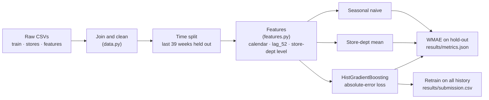
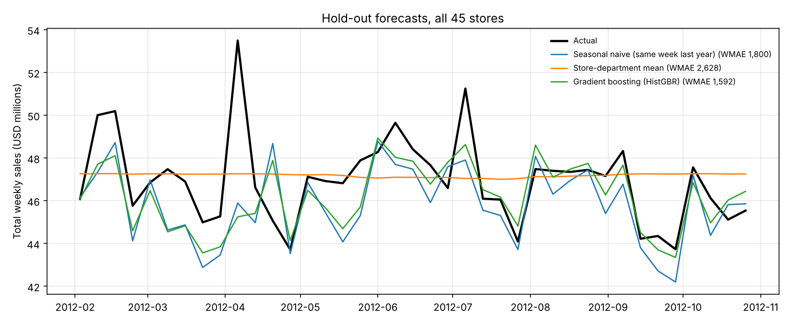

<div align="center">

# Walmart Weekly Sales Forecast

**A forecasting pipeline that predicts weekly sales for 3,331 store and department pairs across 45 Walmart stores, scored with the holiday-weighted error used by Walmart's own Kaggle competition.**

[](https://github.com/Collinsthe4th/walmart-sales-forecast/actions/workflows/ci.yml)
[](https://www.python.org/)
[](https://scikit-learn.org/)

</div>

---

## Contents

- [About the project](#about-the-project)
- [Pipeline](#pipeline)
- [Tech stack](#tech-stack)
- [Results](#results)
- [Interactive dashboard](#interactive-dashboard)
- [Getting started](#getting-started)
- [Project structure](#project-structure)
- [Limitations](#limitations)

## About the project

Retailers plan stock, staff and promotions weeks ahead, so a weekly forecast that is off by a few thousand dollars per department adds up to a lot of money across a chain. The data comes from the Walmart Recruiting competition on Kaggle. It holds 421,570 weekly sales records from February 2010 to October 2012, together with store size and type and regional data such as temperature, fuel price, CPI (consumer price index), unemployment and five promotional markdowns.

I set out to answer one question. Can a single machine learning model beat the simple rule that "sales this week will look like the same week last year"? That rule is hard to beat in retail, because most of the pattern is yearly.

## Pipeline



The main design choices are listed below.

1. **Validation that matches the real task.** The Kaggle test period is 39 weeks long, so I held out the last 39 weeks (3 February to 26 October 2012, 115,588 rows) and trained only on the weeks before them.
2. **No features that would not exist at forecast time.** Last week's sales are not known 39 weeks ahead, so I left them out. Instead the model uses `lag_52` (the sales of the same store, department and week one year earlier), which is always known.
3. **A loss that matches the metric.** The competition metric is WMAE (weighted mean absolute error, where holiday weeks count five times). I trained the model with an absolute-error loss and gave holiday weeks a weight of 5.

## Tech stack

| Area | Tools |
|---|---|
| Data handling | pandas, NumPy |
| Modelling | scikit-learn `HistGradientBoostingRegressor` |
| Evaluation | custom WMAE metric, time-based hold-out |
| Visualisation | Matplotlib |
| Testing | pytest, GitHub Actions |

## Results

| Model | WMAE on hold-out (USD) |
|---|---|
| Store-department mean | 2,628.04 |
| Seasonal naive (same week last year) | 1,800.26 |
| **Gradient boosting (HistGBR)** | **1,591.93** |

Table 1- Hold-out error of each model over the 39 weeks from February to October 2012.

The gradient boosting model had the lowest error, 1,591.93 dollars per store-department-week. That is 11.6% lower than the seasonal naive rule. This shows that the extra information (store size, promotions, the department's usual level and the calendar) adds value on top of last year's pattern. The store-department mean was the worst by a gap of 1,036 dollars, which means that ignoring seasonality is not an option for this data.



Fig. 1- Total weekly sales of all 45 stores against each forecast. Source: Collins Akagha (2026).

Two things stand out in Fig. 1. First, every model misses the spike in the first week of April. Upon further research, I found that this is Easter, which fell on 24 April in 2011 but on 8 April in 2012. Because `lag_52` lines up weeks by date and not by holiday, the model looked for the Easter spike in the wrong week. Second, the error is largest in the type A stores (mean absolute error of 1,888.98 dollars) and smallest in the type C stores (779.71 dollars). This is expected, as type A stores are the largest and sell the most.

All numbers above come from `results/metrics.json`, which `scripts/run_pipeline.py` writes on every run.

## Interactive dashboard

The Streamlit app (`streamlit_app.py`) shows the hold-out results. You can pick any store and department and compare the actual sales with both forecasts week by week, together with the WMAE for that pair.

```bash
streamlit run streamlit_app.py
```

## Getting started

```bash
git clone https://github.com/Collinsthe4th/walmart-sales-forecast.git
cd walmart-sales-forecast
python -m venv .venv && source .venv/bin/activate   # Windows: .venv\Scripts\activate
pip install -r requirements.txt

python scripts/run_pipeline.py    # trains, evaluates, saves results/ and models/ (about 1 minute)
python scripts/predict_test.py    # writes results/submission.csv for the Kaggle test weeks
python -m pytest -q               # unit tests on synthetic data
```

The raw files are included in `data/raw/`. If you prefer to download them yourself, they come from the [Walmart Recruiting - Store Sales Forecasting](https://www.kaggle.com/c/walmart-recruiting-store-sales-forecasting) competition.

## Project structure

```
walmart-sales-forecast/
├── data/raw/                 # train, test, stores and features CSVs from Kaggle
├── src/walmart_forecast/
│   ├── data.py               # loads and joins the four files
│   ├── features.py           # calendar, lag_52, store-department level, time split
│   └── models.py             # WMAE metric, baselines, gradient boosting model
├── streamlit_app.py          # interactive dashboard of the hold-out results
├── scripts/
│   ├── run_pipeline.py       # hold-out evaluation, figure, final model
│   └── predict_test.py       # Kaggle-format forecast for the test weeks
├── results/                  # metrics.json, figures/, hold-out predictions, submission.csv
└── tests/                    # pytest unit tests
```

## Limitations

The hold-out period has only two holiday weeks (the Super Bowl and Labour Day). Thanksgiving and Christmas, the weeks that matter most for WMAE, fall outside it, so I cannot be sure how the model does on them. Also, `submission.csv` has not been scored on Kaggle, so I only report the hold-out numbers above. Finally, moving holidays such as Easter are not handled yet. Adding a "weeks to Easter" feature is the next step I would take.

In conclusion, a gradient boosting model with features that respect the forecast horizon beat the standard seasonal rule by 11.6%, and the remaining error points clearly at holiday alignment as the place to improve.
